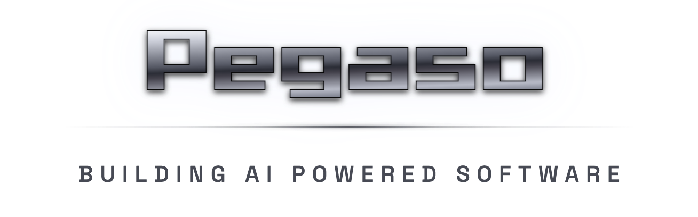
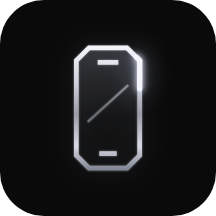

<picture>
<source srcset="assets/pegaso-lockup-dark.png" media="(prefers-color-scheme: dark)" />

</picture>

**Pegaso Software designs, builds and operates software for businesses that run on it.**

Every product starts as a written specification. An AI-powered engineering pipeline turns it into a plan traced to each requirement, builds it with agents working in parallel, and puts every change through tests, review and merge gates before it reaches production. What comes out is AI systems, commerce platforms, native mobile apps, on-chain products, desktop software and game systems, deployed, monitored and maintained by the team that built them.

<table>
<tr>
<td align="center" width="90"><picture><source srcset="assets/discipline-ai.png" media="(prefers-color-scheme: dark)" /></picture> <b>AI</b></td>
<td><b>AI Systems</b> AI that does real work inside the software process and inside the business: agent pipelines that turn an approved specification into a plan traced to every requirement, implement it in parallel on isolated branches, write the tests before the domain code and put every change through review before it merges; independent AI audits of specifications and plans before anything is built; customer-facing assistants with intent routing, hardened prompts and bot checks that fail closed, handing people to the channel where they actually reply. DELIVERED: OUR OWN PRODUCTS BUILT THROUGH THE PIPELINE; A CONCIERGE ANSWERING FOR A LIVE BUSINESS · AGENTS · WORKERS AI · EDGE</td>
</tr>
<tr>
<td align="center" width="90"><picture><source srcset="assets/discipline-web.png" media="(prefers-color-scheme: dark)" /></picture> <b>WEB</b></td>
<td><b>Web Platforms</b> Commerce and service platforms engineered from an empty repository and then operated: storefronts taking Pix, card and boleto, every payment confirmed by webhook and never by the browser; pricing that refuses to sell below cost whatever a discount claims; operator consoles for fulfilment, coupons and moderation; service sites served from the edge and built for local search. DELIVERED: A LIVE STORE AND A LIVE SERVICE OPERATION · NEXT.JS · NODE · CLOUDFLARE</td>
</tr>
<tr>
<td align="center" width="90"><picture><source srcset="assets/discipline-mobile.png" media="(prefers-color-scheme: dark)" /></picture> <b>MOBILE</b></td>
<td><b>Mobile Applications</b> Native apps for iOS and Android from one codebase, built to keep working offline: progress saved on the device and synced to a server that has the final word; subscriptions through the App Store and Google Play, verified on the server before anything unlocks; sign in with Apple and Google; push reminders; content shipped in versioned packs, so lessons and catalogues update without a store release. Mini apps inside Telegram follow the same rules: every session verified, the wallet as the way to pay. DELIVERED: A TELEGRAM MINI APP PAST A MILLION SIMULTANEOUS USERS AT PEAK · REACT NATIVE · EXPO · TWA</td>
</tr>
<tr>
<td align="center" width="90"><picture><source srcset="assets/discipline-blockchain.png" media="(prefers-color-scheme: dark)" /></picture> <b>BLOCKCHAIN</b></td>
<td><b>Blockchain Systems</b> On-chain products where the wallet is the account: sign-in by message signature; transactions the server composes and the wallet only signs; buildings split into tradable fractions and raised through all-or-nothing offerings; subscriptions paid and verified on chain; payment flows that stay correct when a confirmation is slow or a connection drops. DELIVERED: TOKENIZED REAL ESTATE, A RUNES LAUNCHPAD, ON-CHAIN SUBSCRIPTIONS · TON · BITCOIN · EVM</td>
</tr>
<tr>
<td align="center" width="90"><picture><source srcset="assets/discipline-desktop.png" media="(prefers-color-scheme: dark)" /></picture> <b>DESKTOP</b></td>
<td><b>Desktop Applications</b> Professional desktop software in C++: native interfaces over real-time 3D viewports, the docked panels and tools specialists work in all day, and module boundaries that keep a long-lived codebase safe to change while the product keeps selling. DELIVERED: FEATURES STILL SHIPPING IN A COMMERCIAL 3D CAD SUITE · C++ · QT · OPENGL</td>
</tr>
<tr>
<td align="center" width="90"><picture><source srcset="assets/discipline-game.png" media="(prefers-color-scheme: dark)" /></picture> <b>GAME</b></td>
<td><b>Game Systems</b> Progression and reward systems that bring people back: levels, streaks and achievements tuned against a simulation before players see them; timed reward windows and referral tiers with an explicit claim; 3D play rendered in the page; every reward settled against a server-side ledger, so the economy always balances. DELIVERED: A PLAY ECONOMY IN PRODUCTION · R3F · WEBGL</td>
</tr>
</table>

<table>
<tr><td width="230"><b><a href="https://pegasosoftware.com/work/copasportstore">Copa Sport Store</a></b> E-COMMERCE · LIVE</td><td>A Brazilian football kit store engineered end to end: storefront, Pix and card payments reconciled by webhook, pricing that never sells below cost, and the operator console behind it.</td></tr>
<tr><td width="230"><b><a href="https://pegasosoftware.com/work/caretouchcleaning">Care Touch Cleaning</a></b> SERVICES · LIVE</td><td>The digital operation of a cleaning company across Maryland, DC and Virginia: a site served from the edge and built for local search, and an AI concierge that hands visitors to text or WhatsApp.</td></tr>
<tr><td width="230"><b><a href="https://pegasosoftware.com/work/toygers">Toygers</a></b> MOBILE · WEB3 · ARCHIVED</td><td>A Telegram marketplace on TON for limited-edition physical collectibles minted as NFTs, which peaked above a million simultaneous users.</td></tr>
<tr><td width="230"><b><a href="https://pegasosoftware.com/work/horizon">Horizon</a></b> WEB3 · ARCHIVED</td><td>Real estate on chain: each building one token, its equity split into tradable fractions, raised through all-or-nothing offerings.</td></tr>
<tr><td width="230"><b><a href="https://pegasosoftware.com/work/runesland">Runes Land</a></b> WEB3 · ARCHIVED</td><td>A launchpad and trading terminal for Bitcoin Runes through the 2024 wave, every purchase a server-built transaction the wallet signs.</td></tr>
<tr><td width="230"><b><a href="https://pegasosoftware.com/work/agoraai">Agora AI</a></b> AI · ARCHIVED</td><td>An AI model marketplace inside Telegram, each answer gated by a subscription paid in TON and verified on chain.</td></tr>
<tr><td width="230"><b><a href="https://pegasosoftware.com/work/satview">SatView</a></b> WEB3 · ARCHIVED</td><td>A trading desk for Bitcoin's BRC-20 tokens: candlesticks, order books and a lot aggregator over data indexed from the chain.</td></tr>
<tr><td width="230"><b><a href="https://pegasosoftware.com/work/audaces">Audaces</a></b> 3D SOFTWARE · DELIVERED</td><td>Commercial fashion CAD: garments modelled and simulated in 3D, then unfolded into the patterns a factory cuts and sews.</td></tr>
</table>

- **Specification first.** Each product starts as a written specification the client approves, and every task in the plan traces back to a requirement in it.
- **Money is decided on the server.** Prices, charges, subscriptions and rewards are computed and verified server-side; payment notifications and store receipts are checked before anything unlocks.
- **Tests that are proven to fail.** Domain rules, payments, sync and data migrations are written test-first, and every automated check is shown failing on a planted fault before its pass is trusted.
- **Gated merges and releases.** Type checks, linting, tests, secret scanning and review run on every change; staging mirrors production, and a production release waits for an explicit approval of exactly what goes live.
- **Security tested by attack.** Pages that handle money are attacked with crafted links, poisoned data and hostile inputs before they ship.
- **Operated after launch.** The team that builds a product deploys it, monitors it and ships its fixes through the same gates.

 

TIMEZONE &nbsp; **UTC−3 · São Paulo** &nbsp;&nbsp;&nbsp; SITE &nbsp; **[pegasosoftware.com](https://pegasosoftware.com)** &nbsp;&nbsp;&nbsp; EMAIL &nbsp; **[contact@pegasosoftware.com](mailto:contact@pegasosoftware.com)**

 

**Start with one message.**

© 2026 Pegaso Software Ltda

